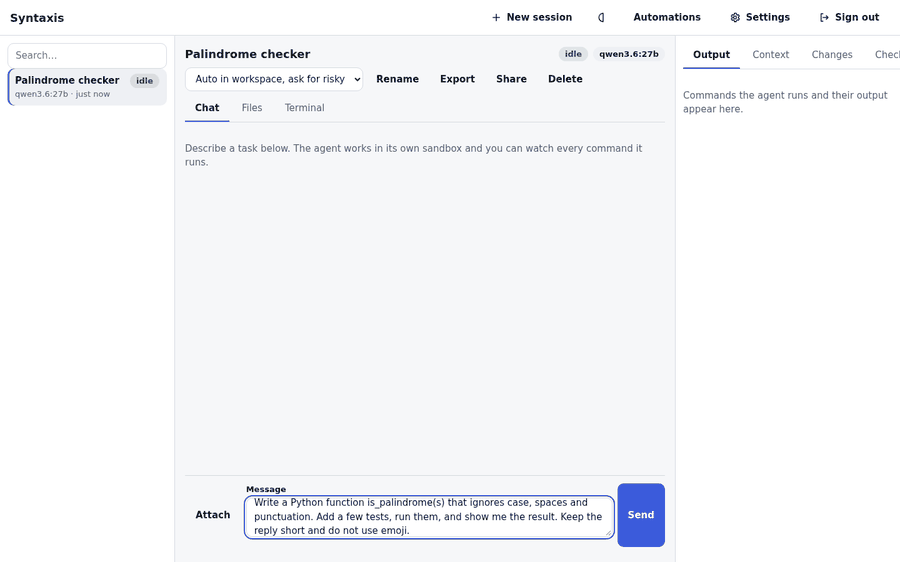
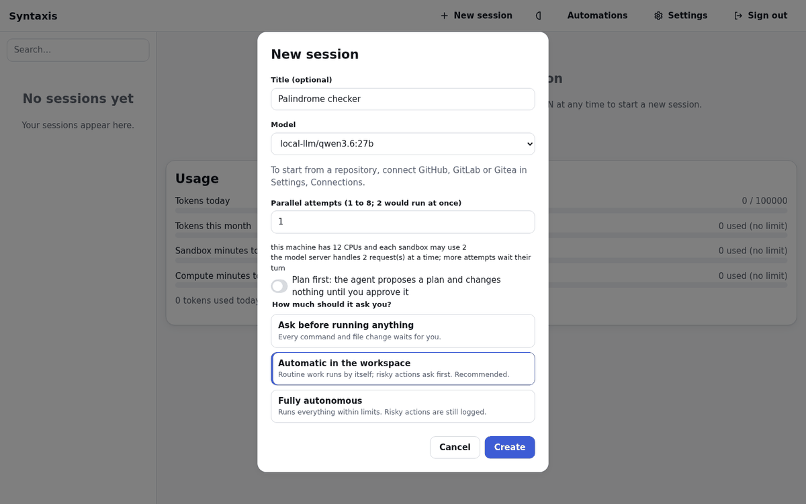
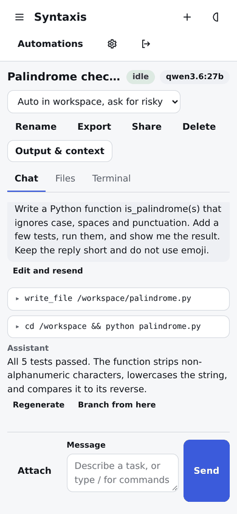
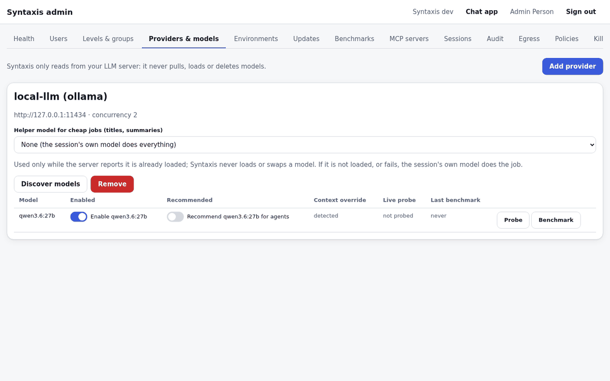

# Syntaxis

[](https://github.com/kolonuk/syntaxis/actions/workflows/ci.yml)
[](LICENSE)
[](https://github.com/kolonuk/syntaxis/releases)

**Give your team an AI coding agent that runs on your own GPU, and keep it in a box.**

Syntaxis is a self-hosted web app. You point it at an LLM server you already run (Ollama, llama.cpp, LiteLLM or anything OpenAI-compatible), invite a few people, and each of them gets chat sessions where an agent writes code, runs commands and uses git. Every session runs in its own [gVisor](https://gvisor.dev/) sandbox, so nobody needs a shell on your host.



*A real session, sped up: the agent writes the file, runs the tests in its sandbox and answers. Model: a 27B model on a local Ollama.*

## What it is, in 30 seconds

- **A chat app for coding agents.** Describe a task; watch every command and its output live; approve or refuse risky steps. It works well on a phone.
- **Safe by default.** The agent's commands run in a disposable sandbox with no route to your LAN or your LLM server. Risky actions wait for a person. Everything important is audited.
- **Built for one shared GPU.** Per-user quotas and a fair queue, so one person cannot use all of the model's capacity. It copes with weaker local models and never loads or swaps models behind your back.
- **For a small trusted group**: a team, a lab, a household of developers. Not a hosted service, and not for the open internet (an admin creates every account).

## Quick start

About 15 minutes, most of it image builds. You need a Linux machine with Docker and an LLM server you already run. On the Docker host, as root:

```sh
git clone https://github.com/kolonuk/syntaxis && cd syntaxis
sudo sh scripts/install.sh --url http://<this-host>:8080 --admin-email you@example.com --llm <llm-server-address>
```

The installer adds gVisor if it is missing, generates the keys, starts everything, keeps the sandbox firewall applied across reboots, and prints a single-use link for your admin account. Then:

1. **Open the link**, choose a password and set up two-factor authentication.
2. **Admin app → Providers & models → Add provider.** Enter your LLM server, press *Discover models* and switch on the ones people may use.
3. **Admin app → Users → Invite user.** They get a link to set a password.
4. **In the chat app, press *New session*,** pick a model and how much the agent should ask you, and describe a task.

The [getting started guide](docs/getting-started.md) explains each step and the options (HTTPS, pinned versions, automatic updates, doing it by hand).

## A look around

| Start a session | On a phone |
| --- | --- |
|  |  |

**You choose how much the agent may do by itself:** ask before everything, automatic inside the workspace (risky actions still ask), or fully autonomous within limits. *Plan first* makes the agent propose a plan and change nothing until you approve it.

**The admin app is separate**, with its own sign-in and two-factor authentication: models, users, quotas, health, audit log, egress and a kill switch.



## Why another LLM UI?

Most chat UIs for local models stop at conversation. Coding agents can do real work, but they normally run as a command-line tool on your own machine, with your files and your network within reach. Syntaxis sits between the two: the agent really runs code, but inside a sandbox you control, for several people at once, on hardware you already have.

It is not a hosted service, and a gVisor container is not a virtual machine. The honest limits are in [security](docs/security.md).

## What you get

**Working with the agent**
- An agent that edits files, runs commands, uses git and can load project-specific skills
- Sessions that start from your own GitHub, GitLab or Gitea repository, work on their own branch and open pull requests
- Approval gates, three levels of autonomy, and a plan-first mode
- Checkpoints you can roll back, without touching your own git history
- Attach files, pictures and PDFs (scans are read with OCR; uploads are off until an admin turns them on), browse and edit the workspace in a Files tab, and follow the agent's task list
- Slash commands, hooks, notes the agent keeps between sessions, optional web search, and edit, regenerate or branch a conversation
- Several attempts at one task side by side, with a comparison to keep the best
- Automations that start a session on a schedule, a webhook or when something new appears (a release, a feed, a package)
- Disposable, read-only links to share a session, and a small [API](docs/api.md) with personal tokens

**Running it for others**
- Per-user quotas, levels and groups, and a fair queue for the shared model
- Connections to GitHub, GitLab, Gitea, Cloudflare, AWS, Azure, Google Cloud and IFTTT, each user's own, in an encrypted vault
- Network controls that keep sandboxes away from your LAN and your LLM server, with per-user egress modes
- Sandbox environments (for example Rust or Java) that admins approve and that a repository's `devcontainer.json` can pick
- Secret scanning, optional signed commits, and MCP servers run in their own sandboxes
- A health page that explains problems in plain language, verified backups, and signed releases

## About the name

*Syntaxis* is the Greek word (σύνταξις) for "arranging things together", and the origin of the English word *syntax*. That is the project in one word: a place where code is written, where models, users, quotas and sandboxes are arranged into one orderly system, and where every session gets its own well-defined place to work.

## Documentation

[Getting started](docs/getting-started.md) · [Configuration](docs/configuration.md) · [Security](docs/security.md) · [Architecture](docs/architecture.md) · [The agent](docs/agent.md) · [API](docs/api.md) · [Integrations](docs/integrations.md) · [Troubleshooting](docs/pitfalls.md)

## Project

Syntaxis is pre-1.0 (the latest release is on the [releases page](https://github.com/kolonuk/syntaxis/releases)); [todo.md](todo.md) lists the work that is left. Issues and pull requests are welcome: see [CONTRIBUTING.md](CONTRIBUTING.md). Report vulnerabilities privately: [SECURITY.md](SECURITY.md). Changes are in the [changelog](CHANGELOG.md).

Licensed GPL-2.0-or-later. See [LICENSE](LICENSE).
