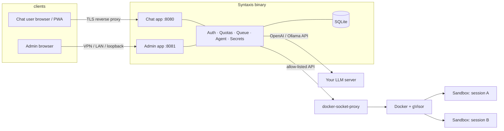

# Syntaxis

[](https://github.com/kolonuk/syntaxis/actions/workflows/ci.yml)
[](LICENSE)
[](https://github.com/kolonuk/syntaxis/releases)

**Sandboxed AI coding sessions on the models you already run.**

Give your friends or team sandboxed AI coding sessions on the models you already run at home. Each session is its own isolated gVisor sandbox with git and a shell; the agent writes, runs and deploys code; you control models, quotas and access. Syntaxis is a single self-hosted binary that sits in front of your Ollama, llama.cpp, LiteLLM or any OpenAI-compatible server. It is for people who run a local LLM server and want a small, trusted group to use it for real software work, without handing anyone a shell on the host.

> Not for the open internet. There is no sign-up: an admin creates every account. Put Syntaxis behind TLS and a reverse proxy or SSO; do not expose it raw.

## Why Syntaxis

- **Self-hosted, bring your own LLM.** It connects to a server you already run. It never pulls, loads or deletes models.
- **Per-session isolation.** Every session gets its own gVisor (`runsc`) container: non-root, all capabilities dropped, read-only root, size-capped workspace.
- **Per-user quotas.** Token quotas (the real cost of a shared GPU) plus time, rate and parallelism limits, enforced server-side.
- **No sign-up, admin-controlled.** Separate admin and chat accounts; invites by email; mandatory 2FA for admins.
- **Fair sharing of one GPU.** A per-provider queue never exceeds the server's concurrency, serves interactive work first and shares fairly between users.
- **Single binary.** Static Go binary with the web UI embedded; SQLite by default, one container to run.

**What it is not:** it is not a hosted service, it is not hardened for the public internet, and a gVisor container is not a virtual machine. Read [docs/security.md](docs/security.md) for the honest threat model.

## Features

- Chat UI (installable PWA, light/dark, phone-friendly) with a live activity terminal, approvals, context meter and offline message queue
- Built-in agent loop: shell, read/write/patch files, ripgrep, git, fetch, ask-the-user, skills; tolerant of weaker local models
- Approval gates for risky actions (force push, `terraform apply`, cloud deletes, deploys, paid resources) with three autonomy levels
- Context management: stays under the model's *real* window, head+tail truncation, compaction at ~75% with a running summary
- Workspace checkpoints in a hidden shadow git repo (your own `.git` is never touched), undo and restore
- `syntaxis.md` project rules; other agents' files (`AGENTS.md`, `CLAUDE.md`, …) are shown as untrusted advice
- Secrets vault (AES-256-GCM), output redaction, built-in secret scanner on commit/push with an audited user override
- Optional server-side SSH commit signing (the key never enters the sandbox)
- Egress policy (open / allowlist / none) that always blocks the host, LAN, metadata endpoints, the LLM server and SMTP; DNS resolver with rebinding protection and logging
- Health-check engine (`syntaxis doctor`, admin Health page, plain-language user banners)
- Tamper-evident audit log, backups, admin kill switch

## Architecture



More in [docs/architecture.md](docs/architecture.md).

## Screenshots

*(placeholders — add real screenshots once you have an instance running)*

| Chat + terminal | Admin health | Mobile |
| --- | --- | --- |
| `docs/img/chat.png` | `docs/img/health.png` | `docs/img/mobile.png` |

## How a session works

1. An admin invites you; you set your own password from the emailed link (and turn on 2FA).
2. You start a session, pick a model you are allowed to use, and describe a task.
3. Syntaxis checks your quota, queues the request fairly, and sends the conversation plus tool definitions to the model.
4. The model replies with text or tool calls. Every tool runs **inside your sandbox**, never on the host, with timeouts and output caps; risky ones pause for your approval.
5. Output streams to your browser. The run is a background job: close the tab and it keeps going; you get a notification when it finishes or needs you.
6. Every turn is checkpointed. Review the diff, roll back, push a branch.

## Comparison with alternatives

Factual and incomplete; these are different tools with different goals.

| | Syntaxis | Hosted coding agents | Running an agent CLI yourself | Chat UIs for local LLMs |
| --- | --- | --- | --- | --- |
| Where it runs | Your hardware | Vendor cloud | Your machine | Your hardware |
| Models | Any server you run | Vendor-chosen | Configurable | Any server you run |
| Isolation per user/session | gVisor container per session | Vendor VM/container | None by default | n/a (no code execution) |
| Multi-user, quotas, admin | Yes | Account-based | No | Varies |
| Code execution | Yes, sandboxed | Yes | Yes, on your machine | Usually no |

## Quick start

Requirements: Docker, [gVisor](docs/getting-started.md#install-gvisor-runsc), and an LLM endpoint (Ollama, llama.cpp, LiteLLM or any OpenAI-compatible server).

```sh
git clone https://github.com/kolonuk/syntaxis && cd syntaxis
sh scripts/install-gvisor.sh                       # once, as root on the Docker host
docker build -t syntaxis-sandbox:latest images/sandbox
cp .env.example .env
docker run --rm ghcr.io/kolonuk/syntaxis keygen    # paste the output into .env as SYNTAXIS_MASTER_KEY
docker compose up -d
docker compose exec syntaxis syntaxis admin create you@example.com "Your Name"
# open http://127.0.0.1:8081 (admin), add your LLM provider, enable models, invite users
```

Full steps, including firewall rules for the sandbox network: [docs/getting-started.md](docs/getting-started.md).

## Documentation

[Getting started](docs/getting-started.md) · [Configuration](docs/configuration.md) · [Security & threat model](docs/security.md) · [Architecture](docs/architecture.md) · [The agent](docs/agent.md) · [Integrations](docs/integrations.md) · [Pitfalls & troubleshooting](docs/pitfalls.md) · [Licensing](docs/licensing.md) · [Contributing](CONTRIBUTING.md) · [Reporting vulnerabilities](SECURITY.md) · [Changelog](CHANGELOG.md)

## Status and roadmap

v1 is under active development: see [todo.md](todo.md) for what works, what is partial and what needs a real host to verify. After v1: scheduled/triggered runs, devcontainer support, PostgreSQL backend, OIDC login, multi-instance provider fallback, read-only session sharing, usage reports, Cloudflare/registrar plugins, Grafana dashboards, user groups.

## Contributing

Issues and pull requests are welcome; see [CONTRIBUTING.md](CONTRIBUTING.md).

## Licence

GNU General Public License, version 2 or (at your option) any later version (`GPL-2.0-or-later`). See [LICENSE](LICENSE) and [docs/licensing.md](docs/licensing.md).

## Security note

Put Syntaxis behind TLS and a reverse proxy or SSO. Keep the admin address on loopback, a LAN or a VPN. Syntaxis assumes **trusted** users: the egress policy and gVisor limit damage, they do not make untrusted users safe. Report vulnerabilities privately: [SECURITY.md](SECURITY.md).
