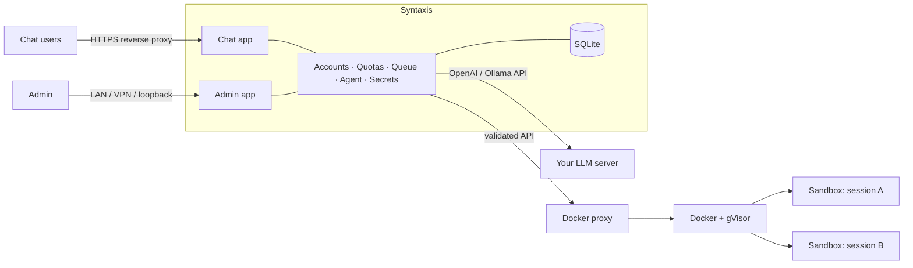

# Architecture

How the pieces fit together. To install it, see [getting started](getting-started.md).

Syntaxis is one Go service with the web apps built in. The chat app and the admin app are separate listeners with their own accounts and cookies. State is in SQLite, which suits a few users on one machine and makes a backup a single file (`syntaxis backup`).

## What happens when a user sends a message

1. The message starts a **background run**, so closing the browser does not stop it.
2. The run gets the session's sandbox (a gVisor container with the user's workspace) and builds the prompt from the project's rules and skills.
3. Each model call checks the user's quota, waits its turn in the provider's fair queue, goes to your LLM server and records the tokens used.
4. Each tool call the model makes is checked against the approval policy (risky ones wait for the user) and then runs **inside the sandbox**, with a time limit and a cap on output.
5. Output is stripped of secrets, saved, trimmed for the model and streamed to the browser.

## What trusts what

- The sandbox never holds provider keys, the master key or the signing key, and cannot reach your LLM server directly.
- Only the validating Docker proxy touches the Docker socket. It refuses anything that is not a hardened gVisor sandbox. See [security](security.md).
- Per-user things (workspace, secrets, connections, automations) belong to one user and are not visible to others.

The code lives under `internal/`, one package per concern (`agent`, `sandbox`, `egress`, `auth`, `quota`, `queue`, `provider`, `store` and so on); the web apps are in `web/`.
