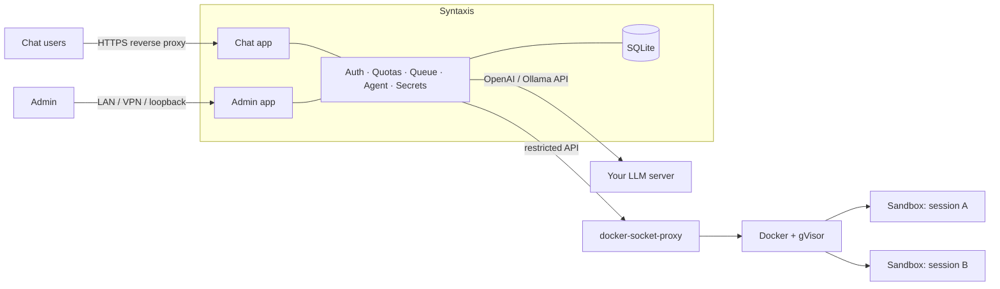

# Architecture

How the pieces fit together. For setup see [getting started](getting-started.md).



## Components

| Package | Role |
| --- | --- |
| `cmd/syntaxis` | CLI: `serve`, `admin create`, `keygen`, `doctor`, `backup`, `rotate-key`, `egress-rules` |
| `internal/server` | Two HTTP apps (chat, admin) sharing no routes or cookies; SSE run streaming; background run registry; agent wiring |
| `internal/auth` | Accounts, argon2id, TOTP, recovery codes, invites/resets, rotation policy, lockout, sessions, CSRF |
| `internal/store` | `Store` interface + SQLite (WAL, pure Go, goose migrations, portable SQL) |
| `internal/provider` | Read-only adapters: Ollama, llama.cpp, LiteLLM, OpenAI-compatible |
| `internal/queue` | Per-provider fair scheduler: concurrency cap, priority classes, per-user round-robin |
| `internal/quota` | Token/rate/parallel/session/time limits, checked before enqueue and sandbox start |
| `internal/agent` | Agent loop, tools, approval policy, tolerant tool-call parser, context budgeting and compaction |
| `internal/sandbox` | Hardened container spec + validator, Docker runtime, manager, reaper, watchdog, kill switch |
| `internal/egress` | Egress policy, nftables generator, DNS resolver |
| `internal/checkpoint` | Shadow-git workspace checkpoints |
| `internal/rules` | `syntaxis.md`, advisory foreign files, skills |
| `internal/secrets`, `internal/vault` | Encrypted secrets vault |
| `internal/scanner`, `internal/redact` | Secret scanner and output redaction |
| `internal/signing` | Server-side SSH commit signing |
| `internal/health`, `internal/doctor` | Health-check engine (pure checks) and live collectors |
| `internal/routing` | Optional helper-model routing (off by default) |
| `internal/audit` | Hash-chained audit entries |
| `web/` | React + TypeScript + Vite frontend (chat app and admin app), built into `internal/webui/dist` and embedded |

## Storage

SQLite is the default: the target is a handful of users on one server, and a backup is a single file (`syntaxis backup`). The SQL is portable, so PostgreSQL can be added later for more concurrent users or multiple instances.

## A request, end to end

1. Browser `POST /api/sessions/{id}/messages` → ownership check → `Runs.Start` launches a **background job** (context not tied to the HTTP request).
2. The job ensures a sandbox (creating one under gVisor with the user's workspace volume and the user's secrets injected as environment variables), loads rules and skills, builds the system prompt.
3. Each model call: quota check → queue (priority class, fair share) → provider adapter → usage recorded.
4. Tool calls are classified by the approval policy; risky ones checkpoint and wait for the user; then they execute **inside the sandbox** via the Docker exec API with timeouts and output caps.
5. Output is redacted, stored in full in history, truncated head+tail for the model, and streamed over SSE (replayable for late subscribers).

## Trust boundaries

```
[browser] ─TLS─▶ [reverse proxy] ─▶ chat app (8080)        admin app (8081, loopback/VPN) ◀─ [admin browser]
                                        │
                      Syntaxis process (secrets, DB, policy)
                        │                         │
           docker-socket-proxy             LLM server (never reachable from sandboxes)
                        │
        gVisor sandbox per session ── egress firewall + DNS resolver ──▶ internet (policy)
```

- The sandbox never holds provider keys, the master key or the signing key, and never talks to the LLM server directly.
- Only the Syntaxis process and the socket proxy touch Docker.
- The admin app is a different listener, cookie, route set and account table.

## Concurrency model

Runs are goroutines owned by `Runs`; each model call passes through the provider's scheduler, so total in-flight calls never exceed the configured concurrency. Quotas are checked before enqueue so exhausted users never occupy a slot.
