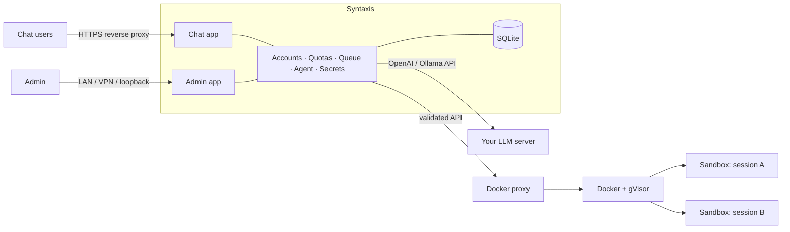

# Architecture

How the pieces fit together. To install, see [getting started](getting-started.md).

Syntaxis is one Go service with the web apps built in. The chat app and the admin app are separate listeners with their own accounts and cookies. State is in SQLite, which suits a few users on one machine and makes a backup a single file (`syntaxis backup`).

## What happens when a user sends a message

1. The message starts a **background run**, so closing the browser does not stop it.
2. The run gets the session's sandbox (a gVisor container with the user's workspace) and builds the prompt from the project's rules and skills.
3. Each model call checks the user's quota, waits its turn in the provider's fair queue, goes to your LLM server and records the tokens used.
4. Each tool call the model makes is checked against the approval policy (risky ones wait for the user) and then runs **inside the sandbox**, with a time limit and a cap on output.
5. Output is stripped of secrets, saved, trimmed for the model and streamed to the browser.

## What trusts what

- The sandbox never holds provider keys, the master key or the signing key, and cannot reach your LLM server directly.
- Only the validating Docker proxy touches the Docker socket. It refuses anything that is not a hardened gVisor sandbox. See [security](security.md).
- Per-user things (workspace, secrets, connections, automations) belong to one user and are not visible to others.

The code lives under `internal/`, one package per concern (`agent`, `sandbox`, `egress`, `auth`, `quota`, `queue`, `provider`, `store` and so on); the web apps are in `web/`.

## Why sandboxes are containers with gVisor, and how big a workspace can get

**Sandboxes.** Each sandbox is an ordinary Docker container with gVisor (`runsc`) as its runtime. gVisor is not run inside a container, because:

- `runsc` inside a container needs broad capabilities or `--privileged` and relaxed seccomp, which makes the outer container a weak boundary.
- Host firewall rules, per-sandbox CPU and memory metering, the kill switch and the Docker proxy all act on the sandbox's own container; nested, they would see only the outer one.
- gVisor loses its faster platforms (no KVM), I/O gets slower, and running it as the container runtime is the supported way.

The runtime must be installable on the Docker host, so macOS and Windows need the stack in a Linux VM (see the [todo](../todo.md)).

**Workspace size.** The limit is enforced by measuring and stopping (see [security](security.md)), not by the filesystem. Filesystem quotas (XFS project quotas, Docker's `--storage-opt size`) depend on how the host's disks are set up. A RAM-backed volume costs memory for every workspace. A loop-mounted image per user gives a hard cap but needs root on the host to mount and is awkward to resize.
